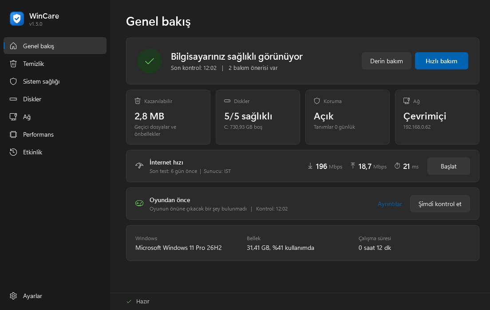

# WinCare


**Windows 11** için sade bir bakım ve onarım uygulaması. Önce bilgisayarınızın sağlığını kontrol eder, yalnızca gerekeni onarır.

**English:** [README.md](README.md)



## Bir bakışta

- **Üçüncü taraf yazılım yok** — başka birine ait program, sürücü ya da bileşen içermez; yalnızca Windows'la birlikte gelen araçları kullanır
- **Taşınabilir, kurulum gerekmez** — zip'i istediğiniz klasöre çıkarıp `WinCare.exe`'yi çalıştırırsınız; her şey o tek klasörde kalır
- **Arka plan hizmeti yok** — hizmet, zamanlanmış görev ya da başlangıç kaydı eklemez. Açın, işinizi yapın, kapatın; kapattıktan sonra hiçbir parçası çalışmaya devam etmez
- **Kayıt defterine yazmaz** — ayarlar ve çalışma geçmişi `WinCare.exe`'nin yanındaki `data` klasöründe küçük dosyalarda durur. Çalışma geçmişi her bilgisayar için ayrı tutulur; başka bir bilgisayara taşınan WinCare o bilgisayara kendi durumuna göre öneri verir
- **Hiçbir veri gönderilmez** — bağlantı kontrolleri yalnızca modeminize ve Cloudflare'e (`1.1.1.1`) ping atar; hız testi yalnızca siz başlattığınızda çalışır
- **Ücretsiz ve açık kaynak** (MIT lisansı), Türkçe ve İngilizce

## Neler yapar

- **Genel bakış** — bilgisayarınız sağlıklı mı, ilgilenmeniz gereken bir şey var mı; son hız testi ve oyundan önce kontrolü
- **Hızlı bakım ve Derin bakım** — güvenli temizlik ve sağlık kontrolü; derin bakım gerekirse onarım da yapar
- **Temizlik** — her konum önce ölçülür, yalnızca seçtikleriniz silinir. Küçük resim, simge, ekran kartı gölgelendirici, Prefetch ve yazı tipi önbelleklerine dokunulmaz
- **Sistem sağlığı** — önce kontrol, yalnızca gerekirse onarım: `DISM /CheckHealth` `/ScanHealth` `/RestoreHealth`,
  `sfc /verifyonly` `/scannow` `/scanfile`, `winmgmt /verifyrepository` `/salvagerepository`, program güncellemesi kontrolü (winget),
  Windows Update sonrası eski dosyaların temizliği ve açılış sorunları için kurtarma ortamı rehberi
- **Diskler** — boş alan, SMART sağlık bilgisi (sıcaklık, aşınma, hatalar), salt okunur dosya sistemi taraması,
  `chkdsk /f` `/r` `/f /r /x`. SSD'ler asla birleştirilmez, yalnızca TRIM uygulanır
- **Ağ** — bağlantı teşhisi, `ipconfig /flushdns`, ağ bağdaştırıcısını yeniden başlatma, internet hız testi;
  `netsh winsock reset` ve `netsh int ip reset` yalnızca siz seçerseniz, uyarıyla çalışır
- **Performans** — bellek kontrolü: gerçekte ne kadar bellek kullanılabilir, programlar ne kadar ayırmış, önbellek,
  sürücü belleği, RAM hızı ve en çok bellek kullanan programlar. Bilerek **"RAM boşalt" düğmesi yoktur**: Windows boştaki
  belleği önbellek olarak kullanır ve bir program isteyince hemen geri verir; bu önbelleği boşaltmak yalnızca işleri yavaşlatır
- **Oyundan önce** — şu an bir oyunun önüne çıkabilecek şeyleri salt okunur olarak kontrol eder: işlemciyi meşgul eden
  programlar (*Windows Update bir şey kuruyor* gibi ipuçlarıyla), bellek, bekleyen yeniden başlatma, pil, dolmak üzere olan
  diskler, Oyun Modu, arka planda kayıt ve ping. Hizmet durdurmaz, "oyun hızlandırıcı" ayarları uygulamaz. Yoğun bir programı
  isterseniz kapatabilirsiniz: bu, programın X düğmesine basmakla aynıdır, kaydedilmemiş iş varsa program size sorar
- **Her komut için geçmiş ve öneri** — en son ne zaman çalıştı, nasıl bitti, şu an gerekli mi
- **Canlı çıktı** — çalışan komut, geçen süre, gerçek ilerleme yüzdesi ve son çıktı satırları
- Windows'un açık/koyu temasını ve vurgu rengini izler

## Güvenlik ilkeleri

- Önce salt okunur kontrol, sonra değişiklik: bir şey değişmeden önce sonucu görürsünüz
- Geri alınamaz işlemler her zaman sorar (Geri Dönüşüm Kutusu, Windows görüntüsü onarımı, bileşen temizliği)
- Her silme işleminde güvenlik kilidi: sürücü kökleri, Windows ve kullanıcı klasörleri asla hedef olamaz
- `/ResetBase` yok, Prefetch silme yok, kayıt defteri "temizliği" yok
- `fsutil dirty set` asla kullanılmaz
- Ağ sıfırlama asla otomatik yapılmaz
- Programlar asla zorla kapatılmaz; Windows'un kendi parçaları ve başka programların içinde çalışan bileşenler WinCare'den kapatılamaz

## İndirme ve kullanım

1. [Releases](https://github.com/borasavkar/WinCare/releases/latest) sayfasından `WinCare-<sürüm>.zip` dosyasını indirin.
2. İstediğiniz bir klasöre çıkarın ve **`WinCare.exe`**'yi çalıştırın. DISM, SFC ve chkdsk yönetici yetkisi gerektirdiği için Windows yönetici izni ister.

> **SmartScreen:** Uygulama henüz kod imzalı değil. Bu yüzden Windows *"Windows bilgisayarınızı korudu"* uyarısı gösterebilir. **Ek bilgi > Yine de çalıştır** ile açabilirsiniz. `WinCare.exe` yalnızca küçük bir başlatıcıdır; kaynak kodu [`launcher/`](launcher/) klasöründedir ve tüm bakım işleri [`src/`](src/) klasöründe okunabilir PowerShell kodudur.

**Gereksinimler:** Windows 11, yönetici yetkisi, Windows PowerShell 5.1 (Windows'ta hazır gelir).

## İndirdiğiniz dosyayı doğrulama

Her sürüm paketi kişisel bir bilgisayarda değil, etiketli kaynak koddan [GitHub Actions](.github/workflows/build.yml) üzerinde derlenir ve imzalı bir derleme kökeni belgesi taşır. [GitHub CLI](https://cli.github.com/) ile:

```
gh attestation verify WinCare-<sürüm>.zip --repo borasavkar/WinCare
```

## Gizlilik

Siz istemedikçe hiçbir bilgi başka bir sisteme gönderilmez. Bağlantı kontrolleri yalnızca modeminize ve Cloudflare'e (`1.1.1.1`) ping atar. İsteğe bağlı internet hız testi yalnızca siz başlattığınızda çalışır ve Cloudflare'in açık hız testiyle (`speed.cloudflare.com`) yalnızca test verisi alışverişi yapar. Ayarlar ve çalışma geçmişi `WinCare.exe`'nin yanındaki `data` klasöründe kalır.

## Kod imzalama politikası

Ücretsiz kod imzalama [SignPath.io](https://signpath.io) tarafından, sertifika [SignPath Foundation](https://signpath.org) tarafından sağlanır.

- Kod yazanlar ve inceleyenler: [borasavkar](https://github.com/borasavkar)
- Onaylayanlar: [borasavkar](https://github.com/borasavkar)

Gizlilik politikası: [Gizlilik](#gizlilik) bölümüne bakın. Bu program, kullanıcı ya da onu kuran veya çalıştıran kişi özellikle istemedikçe başka sistemlere hiçbir bilgi göndermez.

## Kaldırma

WinCare hiçbir şey kurmaz ve hizmet kaydetmez. Kaldırmak için:

1. Görev çubuğuna sabitlediyseniz simgeye sağ tıklayıp **Görev çubuğundan kaldır**'ı seçin.
2. WinCare klasörünü silin.
3. 1.7'den önceki sürümler ayarları ve çalışma geçmişini `%APPDATA%\WinCare` klasöründe tutuyordu; bu klasör varsa onu da silebilirsiniz.

## Lisans

[MIT](LICENSE)

Komutların tam listesi, ne zaman önerildikleri ve geliştirme notları için İngilizce [README.md](README.md) dosyasına bakın.
